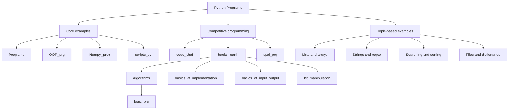

# Python Programs

A categorized collection of Python examples, algorithms, data structures, scripts, and competitive-programming solutions.

**Repository inventory:** 486 Python files across 31 directories.

## Quick navigation

- [Complete program index](docs/program-index.md)
- [Repository overview flowchart](docs/repository-flowchart.md)
- [Core program collections](#core-program-collections)
- [Categorized Python examples](#categorized-python-examples)

## Core program collections

| Collection | Contents | Python files |
|---|---|---:|
| [Programs](Programs/) | Core examples, algorithms, data structures, games, and language features | 83 |
| [Object-oriented programming](OOP_prg/) | Classes, methods, inheritance, properties, and magic methods | 12 |
| [NumPy](Numpy_prog/) | Array creation, attributes, manipulation, and numerical operations | 8 |
| [Utility scripts](scripts_py/) | File, folder, email, reminder, and other automation examples | 14 |
| [Competitive programming](Competitive_Programming/) | CodeChef, HackerEarth, and SPOJ solutions | 129 |
| [Categorized Python examples](python_programs/) | Topic-based examples for lists, strings, dictionaries, files, dates, and algorithms | 207 |

## Competitive programming collections

Solutions are organized by platform and topic under `Competitive_Programming/`.

- [CodeChef](Competitive_Programming/code_chef/)
- [HackerEarth](Competitive_Programming/hacker-earth/)
  - [Algorithms](Competitive_Programming/hacker-earth/Algorithms/)
  - [Logic programs](Competitive_Programming/hacker-earth/Algorithms/logic_prg/)
  - [Basics of implementation](Competitive_Programming/hacker-earth/basics_of_implementation/)
  - [Basics of input/output](Competitive_Programming/hacker-earth/basics_of_input_output/)
  - [Bit manipulation](Competitive_Programming/hacker-earth/bit_manipulation/)
  - [Data structures](Competitive_Programming/hacker-earth/DataStructures/)
- [SPOJ](Competitive_Programming/spoj_prg/)

## Categorized Python examples

The `python_programs/` directory contains standalone examples grouped by topic:

- [Array List Programs](python_programs/Array_List_Programs/) — 33 programs
- [Basic Python Programs](python_programs/Basic_Python_Programs/) — 12 programs
- [Date Time Programs](python_programs/Date_Time_Programs/) — 7 programs
- [Dictionary Programs](python_programs/Dictionary_Programs/) — 24 programs
- [File Handling Programs](python_programs/File_Handling_Programs/) — 16 programs
- [Matrix Programs](python_programs/Matrix_Programs/) — 7 programs
- [More Python Programs](python_programs/More_Python_Programs/) — 24 programs
- [Pattern Programs](python_programs/Pattern_Programs/) — 2 programs
- [Regex Programs](python_programs/Regex_Programs/) — 20 programs
- [Searching Sorting Programs](python_programs/Searching_Sorting_Programs/) — 25 programs
- [String Programs](python_programs/String_Programs/) — 24 programs
- [Tuple Programs](python_programs/Tuple_Programs/) — 13 programs

## Repository map



## How to run

Run a standalone script from the repository root with Python 3:

```bash
python path/to/program.py
```

Some examples may require third-party packages, external services, input files, or environment-specific configuration. Check each script before running it.

## Documentation

- [Complete program index](docs/program-index.md) lists every Python file by directory.
- [Repository overview flowchart](docs/repository-flowchart.md) summarizes how the collections are organized.

> Note: The flowchart describes repository organization, not the internal control flow of every individual script.