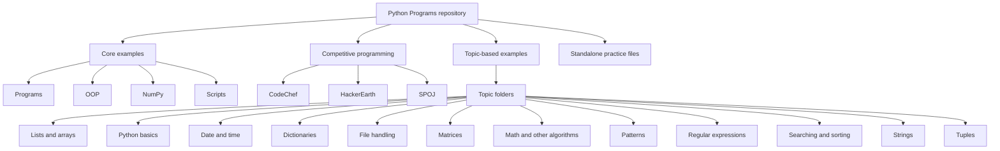

# Repository Overview Flowchart

This diagram shows the repository's directory organization. It is not a call graph and does not imply that scripts execute one another.

## Inventory

- Python files: **486**
- Directories containing Python files: **31**
- Full file-by-file links: [Complete program index](program-index.md)
